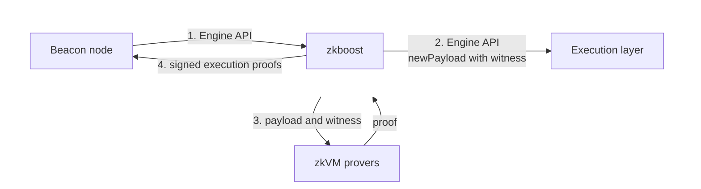

<p align="center">
  
</p>

zkboost is an Engine API proxy between a consensus layer and its execution layer.

1. The CL sends its Engine API requests to zkboost in place of the EL.
2. zkboost forwards every request as is to the EL. Except `engine_newPayloadV5`, it forwards as `engine_newPayloadWithWitnessV5` to get the execution witness in the same request, and reponds the CL without the witness.
3. For each `VALID` payload, every configured zkVM creates the execution proofs 
4. zkboost signs execution proofs as a validator and submits it to the beacon node.



The proving runs after the response to the CL. zkboost forwards without proving until the beacon node responds at startup and a zkVM is connected, and for an EL without `engine_newPayloadWithWitnessV5`.

## Quick Start

See [docker/example/testnet](docker/example/testnet) for a Docker Compose setup that runs zkboost with real Ere backends on a local testnet. See [docker/example/mock-beacon-node](docker/example/mock-beacon-node) for mock backends without a GPU. There `mock-beacon-node` stands in for the beacon node.

## Configuration

zkboost reads a TOML file passed with `--config <path>`. The example shows every option, and an optional one has its default value.

```toml
port = 3000

# Engine API of the EL, and beacon API of the CL that receives the proofs.
el_engine_endpoint = "http://localhost:8551"
cl_beacon_endpoint = "http://localhost:4000"

# EIP-2335 keystore of the signing validator and its password file, as a Lighthouse validator client keeps them.
validator_keystore_path = "/validator-keys/keys/<pubkey>/voting-keystore.json"
validator_keystore_password_path = "/validator-keys/secrets/<pubkey>"

# Built-in dashboard at /dashboard, with the last `retention` blocks.
[dashboard]
enabled = false
retention = 256

# Without a [[zkvm]] entry, zkboost is a plain proxy.

# Remote ere-server.
[[zkvm]]
kind = "ere"
proof_type = "ethrex-zisk"
proof_timeout_secs = 12
endpoint = "http://ere-server:3000"

# ZisK cluster, with the guest ELF from `elf_url` or `elf_path`.
[[zkvm]]
kind = "cluster"
proof_type = "reth-zisk"
endpoint = "http://zisk-cluster:7000"
elf_url = "https://example.com/stateless-validator-reth-zisk.elf"

# OpenVM cluster, the manager of han0110/axiom-edge. Its loadout must hold the guest of the ELF.
[[zkvm]]
kind = "cluster"
proof_type = "reth-openvm"
endpoint = "http://openvm-cluster:3000"
elf_path = "/path/to/stateless-validator-reth-openvm.elf"

# In-process mock. It waits and returns an SSZ `MockProof` with the public values of a valid payload.
[[zkvm]]
kind = "mock"
proof_type = "reth-sp1"
mock_proving_time = { kind = "constant", ms = 6000 }
mock_proof_size = 262144
mock_failure = false

# Mock proving time from a range, or in proportion to the gas used.
[[zkvm]]
kind = "mock"
proof_type = "ethrex-sp1"
mock_proving_time = { kind = "random", min_ms = 2000, max_ms = 8000 }

[[zkvm]]
kind = "mock"
proof_type = "ethrex-openvm"
mock_proving_time = { kind = "linear", ms_per_mgas = 300 }
```

A `proof_type` is one of these names. The first column is its EIP-8025 proof type.

| EIP-8025 | Name              | EL           | zkVM   |
| -------- | ----------------- | ------------ | ------ |
| `1`      | `ethrex-openvm`   | `ethrex`     | OpenVM |
| `2`      | `ethrex-sp1`      | `ethrex`     | SP1    |
| `3`      | `ethrex-zisk`     | `ethrex`     | ZisK   |
| `4`      | `reth-openvm`     | `reth`       | OpenVM |
| `5`      | `reth-sp1`        | `reth`       | SP1    |
| `6`      | `reth-zisk`       | `reth`       | ZisK   |
| `7`      | `zesu-zisk`       | `zesu`       | ZisK   |
| `8`      | `nimbus-sp1`      | `nimbus`     | SP1    |
| `9`      | `nimbus-zisk`     | `nimbus`     | ZisK   |
| `10`     | `nethermind-sp1`  | `nethermind` | SP1    |
| `11`     | `nethermind-zisk` | `nethermind` | ZisK   |
| `12`     | `zilkworm-sp1`    | `zilkworm`   | SP1    |
| `13`     | `zesu-openvm`     | `zesu`       | OpenVM |
| `14`     | `zesu-sp1`        | `zesu`       | SP1    |
| `15`     | `reth-pico`       | `reth`       | Pico   |

## Proof Submission

zkboost submits each proof with `POST /eth/v1/beacon/execution_proofs` to `cl_beacon_endpoint`. The body is the SSZ list of one EIP-8025 `SignedExecutionProofEnvelope`, signed by the configured validator.

It reads these routes of the beacon API.

| Route                                                | Reads                                   | When                      |
| ---------------------------------------------------- | --------------------------------------- | ------------------------- |
| `GET /eth/v1/config/spec`                            | The chain spec                          | At startup                |
| `GET /eth/v1/beacon/genesis`                         | The genesis validators root             | At startup                |
| `GET /eth/v1/beacon/states/head/validators/{pubkey}` | The index of the signing validator      | At startup                |
| `GET /eth/v1/events?topics=execution_payload`        | The beacon block root of each payload   | Streamed                  |
| `GET /eth/v1/beacon/headers?slot=&parent_root=`      | The beacon blocks of the payload slot   | Per payload without event |
| `GET /eth/v2/beacon/blocks/{root}`                   | The payload bid of a listed block       | Per listed block          |

## Mock Beacon Node

`mock-beacon-node` is a sidecar that verifies the execution proofs for a CL without EIP-8025 support. It also shows, as a small reference, what a CL does with a submitted envelope.

- It takes `POST /eth/v1/beacon/execution_proofs` and checks the signature of the validator.
- It verifies the proof with the Ere verifier of its proof type, and compares the public values with those of the payload. A `MockProof` of a mock zkVM needs no proof check.
- The CL sends its Engine API requests through it to zkboost. Every other beacon API request goes to the CL.

See [docker/example/mock-beacon-node](docker/example/mock-beacon-node) for a setup.

## Observability

zkboost serves Prometheus metrics at `/metrics`, and exports traces over OTLP gRPC when `OTEL_EXPORTER_OTLP_ENDPOINT` is set. The `METRICS` table in [crates/server/src/observability/metrics.rs](crates/server/src/observability/metrics.rs) defines every metric.

### Docker Compose with Grafana

The Docker Compose setup has Prometheus, Tempo, and Grafana with a zkboost dashboard. Start the Kurtosis testnet as in [docker/example/observability](docker/example/observability) first.

```bash
docker compose -f docker/example/observability/docker-compose.yml up -d
```

| Service    | URL                   | Credentials   |
| ---------- | --------------------- | ------------- |
| zkboost    | http://localhost:3000 | -             |
| Prometheus | http://localhost:9090 | -             |
| Grafana    | http://localhost:3002 | admin / admin |

### Built-in Dashboard

With `enabled = true` in `[dashboard]`, zkboost serves a live page at `/dashboard`. It shows the witness fetch and the proving of each payload as they happen, and the results, the proving times, and the gas used of the last `retention` blocks. The page follows a server-sent event stream and needs no Prometheus.

## Supported Backends

zkboost integrates backends through Ere. Any backend that Ere supports can be added.

## Contributing

Contributions are welcome!

## License

Dual‑licensed under **Apache‑2.0** and **MIT**. Choose either license at your discretion.
